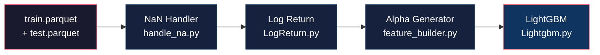

# 🔬 Phản Biện Toàn Diện: Preprocessing Pipeline

> [!NOTE]
> Phân tích dựa trên nguyên tắc AFML (Marcos López de Prado) và best practices trong Quantitative Finance ML.

---

## Tổng quan Pipeline



**Luồng chính**: `inference_preprocess.py` điều phối toàn bộ → Xuất `inference_processed_full.parquet` → `Lightgbm.py` / `FINAL_submit.py` tiêu thụ.

---

## 🔴 Vấn đề Nghiêm trọng (Critical)

### 1. DATA LEAKAGE trong `LogReturn.py` — Feature Detection dùng TOÀN BỘ dữ liệu

**File**: [LogReturn.py:74-77](file:///f:/Projects/hege_fund_kaggle/Modules/Preprocess/LogReturn.py#L74-L77)

```python
# Tự động nhận diện 69 biến toàn dương (min >= 0 và max > 0)
pos_features = [c for c in df.columns if c.startswith('feature_') 
                and not c.startswith('is_nan')
                and c not in meta_cols
                and df[c].min() >= 0]
```

**Vấn đề**: Khi chạy qua `inference_preprocess.py`, `df` là tập **Train + Test đã concat**. Phép `df[c].min() >= 0` sử dụng thông tin từ **cả Test** để quyết định feature nào "toàn dương":

- [inference_preprocess.py:68](file:///f:/Projects/hege_fund_kaggle/Modules/Preprocess/inference_preprocess.py#L68): `pos_features = [f for f in features if df[f].min() >= 0 and df[f].max() > 0]`

Nếu một feature có giá trị âm **chỉ trong Test**, thì nó sẽ bị loại khỏi Log Return — quyết định này bị ảnh hưởng bởi dữ liệu tương lai.

> [!WARNING]
> **Mức độ**: Khả năng ảnh hưởng thực tế **trung bình** (vì tiêu chí "toàn dương" thường ổn định), nhưng vi phạm **nguyên tắc** AFML. Đúng ra phải xác định danh sách `pos_features` **chỉ từ tập Train** rồi áp dụng cố định cho Test.

---

### 2. DATA LEAKAGE trong `handle_na.py` — Median Fill xuyên thời gian

**File**: [handle_na.py:44-53](file:///f:/Projects/hege_fund_kaggle/Modules/Preprocess/handle_na.py#L44-L53)

```python
# Lớp 4: Cross-sectional Median Fill
medians = df.groupby(['ts_index', 'horizon'])[features_list].median()
df[features_list] = df[features_list].fillna(medians)
```

Mặc dù **hiện tại `impute=False` theo mặc định** nên lớp 3 & 4 không chạy, nhưng nếu bật lên:

- **Forward Fill (Lớp 3)** — An toàn ✅ (chỉ nhìn quá khứ)
- **Median Fill (Lớp 4)** — Key `groupby` là `['ts_index', 'horizon']`, nghĩa là tính median của **tất cả các mã tại cùng thời điểm t**. Điều này **an toàn về mặt thời gian** (chỉ dùng thông tin tại t, không dùng t+1). Tuy nhiên, trong pipeline hợp nhất (Train+Test concat), các dòng Test cũng tham gia tính median → **rò rỉ nhẹ**.

> [!NOTE]
> Hiện tại không ảnh hưởng vì `impute=False`. Nhưng nếu bật lại, cần filter `is_test == 0` trước khi tính median.

---

### 3. `np.log1p` trên giá trị ÂM — Lỗi Toán học Im lặng

**File**: [LogReturn.py:36](file:///f:/Projects/hege_fund_kaggle/Modules/Preprocess/LogReturn.py#L36)

```python
log_curr = np.log1p(df[col].values.astype(np.float32))
```

`np.log1p(x) = log(x + 1)`. Nếu `x < -1`, kết quả là `NaN`. Nếu `-1 < x < 0`, kết quả là số âm. 

**Vấn đề kép**:
- Tiêu chí chọn feature là `min() >= 0`, nhưng sau khi NaN Handler chạy (nếu `impute=True`), ffill hoặc median fill có thể tạo ra giá trị âm cho feature vốn dĩ "toàn dương" → `log1p` trả về `NaN` im lặng.
- Ngay cả khi `impute=False`, NaN vẫn tồn tại → `log1p(NaN) = NaN`, `NaN - NaN = NaN` → các cột `_logret` bị NaN ngập lụt mà không có cảnh báo.

> [!CAUTION]
> Không có assertion hay validation nào đảm bảo input của `log1p` thực sự dương. Cần thêm guard clause.

---

### 4. Log Return trên Shifted Value có NaN gây hiệu ứng domino

**File**: [LogReturn.py:40-41](file:///f:/Projects/hege_fund_kaggle/Modules/Preprocess/LogReturn.py#L40-L41)

```python
shifted_vals = grouped[col].shift(self.lag).values.astype(np.float32)
log_prev = np.log1p(shifted_vals)
```

`groupby.shift(1)` tạo `NaN` cho dòng đầu tiên mỗi group → `log1p(NaN) = NaN` → `log_curr - NaN = NaN`. Đây là hành vi **đúng** (không rò rỉ), nhưng:

- Với ~4000-5000 groups × 1 lag = ~4000-5000 dòng NaN **mỗi cột _logret**
- Với ~69 cột pos_features → tổng ~ **280K-345K NaN mới** được inject
- Sau đó `AlphaGenerator` tiếp tục `shift()` trên các cột `_logret` → **NaN lan truyền theo cấp số nhân** (lag=25 → thêm 25 dòng NaN/group/cột)

**Hậu quả**: Dataset cuối cùng có tỷ lệ NaN cao bất thường ở các feature engineered, LightGBM phải xử lý bằng cơ chế default direction → giảm information gain.

---

## 🟡 Vấn đề Đáng Chú Ý (Significant)

### 5. `feature_builder.py` — Shift thủ công có bug tiềm ẩn

**File**: [feature_builder.py:31-36](file:///f:/Projects/hege_fund_kaggle/Modules/Preprocess/feature_builder.py#L31-L36)

```python
res[lag:] = df_values[:-lag]

# Xóa dữ liệu rò rỉ tại ranh giới mỗi group
for start in group_indices:
    if start + lag <= len(res):
        res[start : start + lag] = np.nan
```

Logic: Copy array shift rồi xóa ranh giới. Vấn đề:

- `group_indices` bao gồm index `0` (được `np.insert` ở [L47](file:///f:/Projects/hege_fund_kaggle/Modules/Preprocess/feature_builder.py#L47)). Khi `start=0`, `res[0:lag] = NaN` → Đúng ✅
- Tuy nhiên, nếu data **chưa sort đúng** trước khi tính `group_sizes` thì logic sẽ sai hoàn toàn. Code giả định `df` đã `sort_values` ở L43 — nhưng `sort_values` trả về bản copy, và ở L43 gán lại `df =`, ok.
- **Song song hóa (joblib)**: `df_values` được truyền vào mỗi worker. Nếu NumPy array là shared memory, các worker có thể **viết chồng** lên nhau. Thực tế `res = np.full_like(...)` tạo array riêng nên OK — nhưng `df_values` (input) nếu bị modify bởi worker sẽ gây race condition. Hiện tại không modify, nên OK.

> [!TIP]
> Logic đúng nhưng fragile. Recommend dùng `groupby.shift()` chuẩn của pandas thay vì implement thủ công — sacrifice speed cho correctness.

---

### 6. Z-Score chéo dùng Train + Test data

**File**: [feature_builder.py:94](file:///f:/Projects/hege_fund_kaggle/Modules/Preprocess/feature_builder.py#L94)

```python
stats = df.groupby(['ts_index', 'sub_category'])[col_name].agg(['mean', 'std'])
```

Khi chạy trong pipeline hợp nhất, `df` chứa cả Train và Test. Z-Score được tính:
- Tại `ts_index` chỉ có trong Train → OK (chỉ dùng data tại thời điểm đó)
- Tại `ts_index` chỉ có trong Test → OK (cross-sectional tại thời điểm test)
- Tại `ts_index` overlap → **Không xảy ra** vì Train/Test thường có `ts_index` khác nhau

**Kết luận**: Z-Score **an toàn** vì chỉ dùng thông tin tại cùng thời điểm. ✅ Nhưng cần xác nhận `ts_index` giữa Train và Test **không overlap**.

---

### 7. Hardcode danh sách features trong `AlphaGenerator`

**File**: [feature_builder.py:22](file:///f:/Projects/hege_fund_kaggle/Modules/Preprocess/feature_builder.py#L22)

```python
def __init__(self, lag_features=['feature_al_logret', 'feature_am_logret', 'feature_cg_logret'], ...):
```

Và trong `inference_preprocess.py`:
```python
alpha_gen = AlphaGenerator(lag_features=['feature_al_logret', 'feature_am_logret', 'feature_u_logret'])
```

**Vấn đề**:
1. **Không khớp**: `feature_builder.py` default dùng `feature_cg_logret`, nhưng `inference_preprocess.py` dùng `feature_u_logret`. Nếu chạy standalone vs pipeline → kết quả khác nhau.
2. **Tại sao 3 features này?** Không có justification hay feature importance analysis hỗ trợ. Nếu chọn sai → inject noise vào model.

---

### 8. Memory Optimization downcast TOÀN BỘ float64 → float32

**File**: [inference_preprocess.py:52-53](file:///f:/Projects/hege_fund_kaggle/Modules/Preprocess/inference_preprocess.py#L52-L53)

```python
float64_cols = df.select_dtypes(include=['float64']).columns
df[float64_cols] = df[float64_cols].astype('float32')
```

**Vấn đề**:
- `y_target` (biến mục tiêu) cũng bị downcast → **mất precision** trong tính RMSE. Với RMSE, sai số tích lũy từ float32 rounding có thể ảnh hưởng đến ranking trên leaderboard.
- `weight` cũng bị downcast → ảnh hưởng đến weighted metric.
- `ts_index` nếu là float cũng bị downcast → sort order có thể sai với giá trị lớn.

> [!IMPORTANT]
> Nên loại trừ `y_target`, `weight`, `ts_index` khỏi danh sách downcast.

---

### 9. Constant Column Detection chạy 2 lần, không nhất quán

**Phát hiện** constant columns xảy ra ở:
1. [handle_na.py:72-86](file:///f:/Projects/hege_fund_kaggle/Modules/Preprocess/handle_na.py#L72-L86) — Dùng `min == max` trên non-NaN
2. [Lightgbm.py:178-181](file:///f:/Projects/hege_fund_kaggle/Models/Lightgbm.py#L178-L181) — Dùng `nunique() <= 1`
3. [FINAL_submit.py:69](file:///f:/Projects/hege_fund_kaggle/FINAL_submit.py#L69) — Dùng `nunique() <= 1`

**Sự khác biệt**:
- `min == max` trên non-NaN: Cột `[NaN, NaN, 5]` → `min=5, max=5` → constant ✅
- `nunique() <= 1`: Cột `[NaN, NaN, 5]` → `nunique=1` → constant ✅

Cả hai đều trả về kết quả giống nhau, nhưng:
- **Blacklist hardcode** trong `handle_na.py` (28 cột) → không tự cập nhật nếu data thay đổi
- Nếu handle_na đã xóa const cols, nhưng LogReturn/AlphaGenerator tạo ra const cols mới → LightGBM phải dọn lại

---

### 10. Label Encoding không nhất quán giữa Train/Inference

**File**: [Lightgbm.py:149-153](file:///f:/Projects/hege_fund_kaggle/Models/Lightgbm.py#L149-L153) vs [FINAL_submit.py:48-52](file:///f:/Projects/hege_fund_kaggle/FINAL_submit.py#L48-L52)

Cả hai đều `fit_transform` trên dữ liệu **tại thời điểm chạy**:

```python
le = LabelEncoder()
df[col] = le.fit_transform(df[col].astype(str))
```

- `Lightgbm.py` fit trên **chỉ train processed data** (không chứa test)
- `FINAL_submit.py` fit trên **train + test concat** (inference_processed_full.parquet)

Nếu Test chứa một `code` mới không có trong Train:
- `Lightgbm.py`: code mới không tồn tại → không ảnh hưởng (vì chỉ train)
- `FINAL_submit.py`: code mới được encoding khác mapping → **mismatch** giữa model trained vs inference

> [!WARNING]
> LabelEncoder phải được **fit một lần trên Train**, serialize, rồi **transform** trên Test.

---

## 🟠 Vấn đề Thiết kế (Design Issues)

### 11. `inference_preprocess.py` import `numpy` 2 lần

**File**: [inference_preprocess.py:2,7](file:///f:/Projects/hege_fund_kaggle/Modules/Preprocess/inference_preprocess.py#L2)

```python
import numpy as np  # L2
import numpy as np  # L7
```

Nhỏ nhưng cho thấy code quality cần review.

---

### 12. Không có Outlier Handling trước Log Return

Pipeline hiện tại: `NaN Handler → Log Return → Alpha Generator`. 

Nếu feature có giá trị cực đoan (outlier: VD `feature_x = 1e10`), thì `log1p(1e10) ≈ 23.03` → Log Return vẫn hợp lý. Tuy nhiên:
- Fat-tailed distribution phổ biến trong tài chính → outlier rất hay xuất hiện
- Log Return `= log(X_t/X_{t-1})` có thể tạo spike nếu `X_{t-1}` nhỏ và `X_t` lớn đột ngột
- LightGBM xử lý outlier khá tốt, nhưng Z-Score downstream sẽ bị skew bởi outlier

---

### 13. FracDiff đã bị loại bỏ hoàn toàn — chỉ dùng Log Return

README vẫn đề cập Fractional Differencing, nhưng pipeline thực tế chỉ dùng **Log Return** (sai khác so với tài liệu). Log Return:
- **Ưu điểm**: Đơn giản, nhanh, dễ hiểu
- **Nhược điểm**: Mất toàn bộ "memory" (d=1 tương đương first-differencing) → chuỗi stationary nhưng **không giữ long-range dependence** mà AFML coi trọng

> [!IMPORTANT]
> Log Return (d=1) ≠ Fractional Differencing (0 < d < 1). AFML khuyến nghị dùng d tối ưu (ví dụ d=0.35) để giữ memory. Pipeline hiện tại đánh đổi toàn bộ memory lấy stationarity.

---

### 14. Cross-Sectional Z-Score bị comment out

**File**: [feature_builder.py:151](file:///f:/Projects/hege_fund_kaggle/Modules/Preprocess/feature_builder.py#L151)

```python
# df = alpha_gen.inject_cross_sectional_zscore(df)
```

Và trong `inference_preprocess.py`, Z-Score **không được gọi**. README nói có Z-Score, nhưng thực tế pipeline không sử dụng → **README lừa người đọc**.

---

## 📊 Tổng hợp Đánh giá

| # | Vấn đề | Severity | Ảnh hưởng Score | Fix Effort |
|---|--------|----------|-----------------|------------|
| 1 | pos_features detect dùng Test data | 🔴 Critical | Thấp | Dễ |
| 2 | Median Fill dùng Test data (nếu bật) | 🟡 | Không (chưa bật) | Dễ |
| 3 | log1p trên giá trị có thể âm/NaN | 🔴 Critical | Trung bình | Dễ |
| 4 | NaN lan truyền cấp số nhân | 🟡 | Trung bình | Trung bình |
| 8 | float32 downcast cả y_target/weight | 🟡 | Cao (metric) | Rất dễ |
| 10 | LabelEncoder không nhất quán | 🔴 Critical | Cao | Trung bình |
| 13 | Log Return thay FracDiff — mất memory | 🟡 | Trung bình | Khó |
| 7 | Hardcode lag features không khớp | 🟠 | Trung bình | Dễ |
| 14 | Z-Score bị comment out, README sai | 🟠 | Thấp | Rất dễ |

---

## ✅ Điểm Tốt của Pipeline

1. **Unified Pipeline** (Train + Test concat) — Ý tưởng đúng để bảo toàn memory cho time-series shift/lag.
2. **Forward Fill theo Group** — Đúng nguyên tắc causality (chỉ nhìn past).
3. **Missingness Indicator** — Tốt, cho model biết dữ liệu nào bị khuyết.
4. **Parallel Processing** (joblib) — Tối ưu tốc độ.
5. **LeakFreePurgedKFold** — Đúng chuẩn AFML cho Cross-Validation.
6. **Pseudo-Huber Loss** — Robust hơn MSE cho fat-tailed financial data.

---

## 🎯 Khuyến Nghị Ưu Tiên

### Ưu tiên 1 — Fix NGAY (Ảnh hưởng trực tiếp kết quả):
1. **Loại trừ `y_target`, `weight` khỏi float32 downcast** — 1 dòng code
2. **Fix LabelEncoder**: Fit trên Train, serialize (pickle), transform trên Test
3. **Fix pos_features detection**: Chỉ tính `min()/max()` trên `df[df['is_test'] == 0]`

### Ưu tiên 2 — Cải thiện (Có thể đánh kể improve model):
4. **Thêm validation cho log1p**: `assert (df[col] >= 0).all()` trước khi `log1p`
5. **Thống nhất lag_features** giữa standalone và pipeline execution
6. **Cập nhật README** để phản ánh đúng pipeline thực tế (bỏ FracDiff, bỏ Z-Score)

### Ưu tiên 3 — Strategic (Nâng cấp quality):
7. **Xem xét lại FracDiff** thay cho Log Return — thử nghiệm A/B
8. **Bật lại Z-Score** — feature rất hữu ích cho cross-sectional momentum
9. **Thêm NaN report** sau mỗi bước để track NaN propagation
